  

  <a href="https://asameer.netlify.app">Portfolio</a> ·
  <a href="https://www.linkedin.com/in/abdulsameer9/">LinkedIn</a> ·
  <a href="https://vtu.academia.edu/ABDULSAMEER">Academia.edu</a> ·
  <a href="https://orcid.org/0009-0006-9004-1229">ORCID</a> ·
  <a href="mailto:abdulsameer63167@gmail.com">Email</a>

## About

I’m Abdul Sameer, an AI/ML and full-stack developer and research author. I work across computer vision, healthcare and agriculture applications, web development, and AI product prototypes, with an interest in turning research ideas into useful software.

I enjoy building end-to-end systems and learning through practical projects, research, internships, and hackathons.

## Selected projects

| Project | Focus |
| --- | --- |
| QueueIQ · [Research paper](https://www.academia.edu/167296194/QueueIQ_Real_Time_Hospital_Queue_Intelligence_Using_LSTM_Prediction_Multilingual_NLP_and_RAG_Powered_Health_Education) | Hospital queue intelligence, wait-time prediction, multilingual NLP, and retrieval-augmented health education. |
| [AgriVision](https://github.com/Sameer8549/Agrivision-ai-yit) · [Research paper](https://www.academia.edu/166013399/AgriVision_An_Integrated_Smart_Farming_Platform_Using_Deep_Learning_IoT_and_Drone_Based_Remote_Sensing_for_Precision_Agriculture) | Smart farming and crop-disease diagnosis using computer vision, IoT, and drone-based remote sensing. |
| [NAMMA KSP](https://github.com/Sameer8549/NAMMAKSP) | AI crime-intelligence platform for FIR analysis, offender history, heatmaps, and investigation workflows. |
| [TARANG](https://github.com/Sameer8549/TARANG) | Coastal emergency-response workflows for SOS alerts, vessel tracking, and rescue dispatch. |
| [CipherRanker](https://github.com/Sameer8549/CipherRanker) · [Live demo](https://rankker.netlify.app/) | Recruitment intelligence tool for evidence-based candidate scoring, auditing, and ranked CSV export. |

## Experience & recognition

- Google Student Ambassador
- Campus Ambassador at LetsUpgrade
- Fundraising Intern at She Can Foundation
- Machine Learning Intern at Prodigy InfoTech; Python Intern at CodSoft
- Recognition at IEEE Technnovate 2K25 Mini Project Expo (the existing profile does not specify an award category)
- Virtual internship programs listed on the existing profile: AWS, Walmart, JPMorgan Chase, and Accenture

## Skills

**Software & web:** Python · JavaScript · React · Next.js · FastAPI

**AI & data:** Computer vision · YOLOv8 · OpenCV · LSTM · LightGBM · multilingual NLP · retrieval-augmented generation (RAG) · generative AI

**Platforms & infrastructure:** Firebase · Google Cloud · PostgreSQL · ChromaDB · Docker · Kubernetes · Git · GitHub

*Grouped from the public project repositories and research descriptions; this is a list of technologies used or described in those works, not a proficiency ranking.*

## Research & profiles

- [QueueIQ paper](https://www.academia.edu/167296194/QueueIQ_Real_Time_Hospital_Queue_Intelligence_Using_LSTM_Prediction_Multilingual_NLP_and_RAG_Powered_Health_Education)
- [AgriVision paper](https://www.academia.edu/166013399/AgriVision_An_Integrated_Smart_Farming_Platform_Using_Deep_Learning_IoT_and_Drone_Based_Remote_Sensing_for_Precision_Agriculture)
- [Academia.edu profile](https://vtu.academia.edu/ABDULSAMEER)
- [ORCID](https://orcid.org/0009-0006-9004-1229)

## GitHub activity

*Live contribution graph from a third-party service; it may be unavailable at times.*

  

