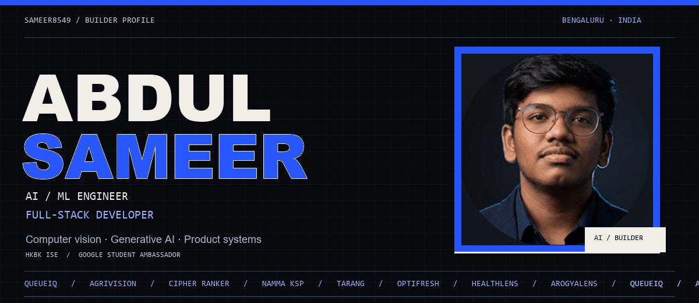
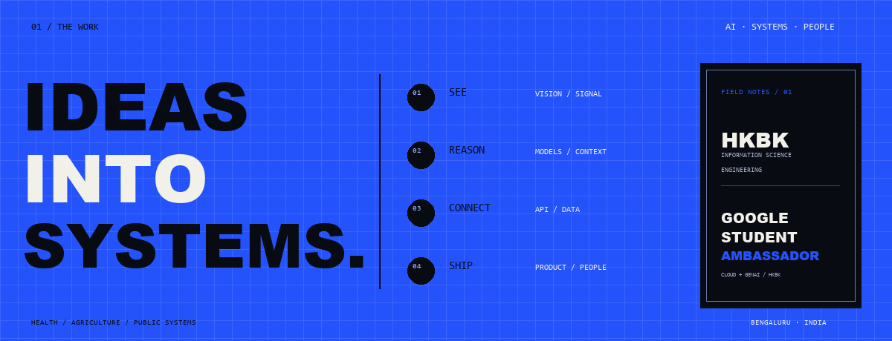
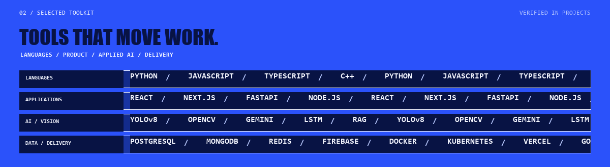
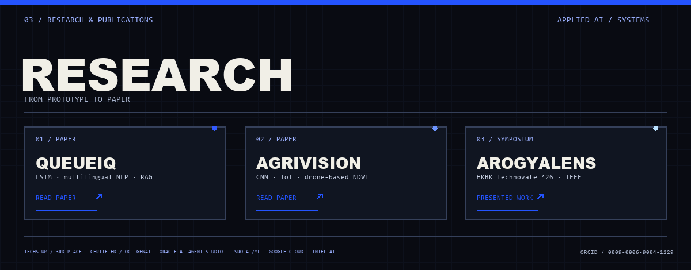
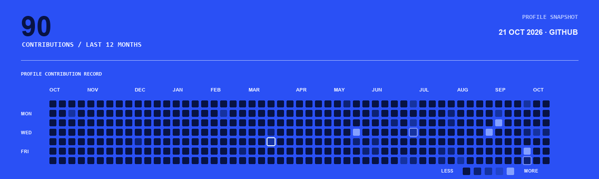
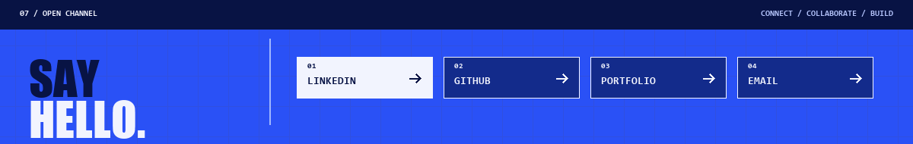

<h1 align="center">Abdul Sameer</h1>

AI/ML Engineer · Full-Stack Developer · Bengaluru, India

<a href="https://asameer.netlify.app/">PORTFOLIO</a> &nbsp; / &nbsp; <a href="https://linkedin.com/in/abdulsameer9">LINKEDIN</a> &nbsp; / &nbsp; <a href="https://github.com/Sameer8549">GITHUB</a>

&nbsp;
&nbsp;
&nbsp;
&nbsp;
&nbsp;
&nbsp;
&nbsp;
&nbsp;
&nbsp;
&nbsp;
&nbsp;
&nbsp;
&nbsp;
&nbsp;
&nbsp;
&nbsp;
&nbsp;
&nbsp;
&nbsp;

### Selected work

| Project | What it does | Focus |
| :--- | :--- | :--- |
| [**AgriVision**](https://github.com/Sameer8549/Agrivision-ai-yit) | Crop diagnosis and precision farming | Computer vision · AI |
| [**RailSense AI**](https://github.com/Sameer8549/RailSense-) · [live](https://railsense-60074625517.development.catalystserverless.in/app/index.html) | Rail Madad passenger flow and staff operations console | PWA · AI · Live systems |
| [**Evidentia**](https://github.com/Sameer8549/evidentia) | Offline-first evidence checks with reproducible receipts | AI · Trust systems |

**More builds:** [QueueIQ](https://github.com/Sameer8549/QueueIQ) · [CipherRanker](https://github.com/Sameer8549/CipherRanker) · [NAMMA KSP](https://github.com/Sameer8549/NAMMAKSP) · [TARANG](https://github.com/Sameer8549/TARANG) · [OPTIFRESH](https://github.com/Sameer8549/OPTIFRESH) · [SpecForge](https://github.com/Sameer8549/SpecForge)

<a href="https://doi.org/10.5281/zenodo.20251618">QUEUEIQ PAPER</a> &nbsp; / &nbsp; <a href="https://www.academia.edu/166013399/AgriVision_An_Integrated_Smart_Farming_Platform_Using_Deep_Learning_IoT_and_Drone_Based_Remote_Sensing_for_Precision_Agriculture">AGRIVISION PAPER</a> &nbsp; / &nbsp; <a href="https://orcid.org/0009-0006-9004-1229">ORCID</a>

<a href="https://linkedin.com/in/abdulsameer9">LINKEDIN</a> &nbsp; / &nbsp; <a href="https://github.com/Sameer8549">GITHUB</a> &nbsp; / &nbsp; <a href="https://asameer.netlify.app/">PORTFOLIO</a> &nbsp; / &nbsp; <a href="mailto:abdulsameer63167@gmail.com">EMAIL</a>

